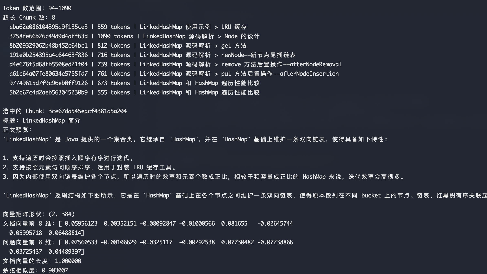

# 1. 最小 RAG

> Embedding、余弦相似度、Chunk、Top-K、向量索引

RAG 全称是 Retrieval-Augmented Generation，即检索增强生成。本笔记用 JavaGuide 的《LinkedHashMap 源码分析》走完离线建库和在线问答。下文运行截图中的原文预览也来自该文档。 [示例原文（固定版本）](https://github.com/Snailclimb/JavaGuide/blob/992dae31eade2a34ba8dbbbcf5ed9de5511325ec/docs/java/collection/linkedhashmap-source-code.md) · [上游许可证](../Java面经知识库/licenses/JavaGuide/LICENSE)

| 部分 | 做什么 | 我们的实现 |
|---|---|---|
| **Retrieval：检索** | 从索引中找出与问题相关的 Chunk | 用 E5 编码问题，按余弦相似度取 Top-K |
| **Augmented：增强** | 把检索内容加入模型上下文 | 将问题、原文片段和来源组装成提示词 |
| **Generation：生成** | 根据问题和参考资料组织答案 | 用 MiniMax-M3.1-Flash 生成带编号引用的答案 |

离线建库负责解析、切分、向量化和落盘。在线问答复用已有索引，依次做 Top-K 检索、上下文组装和答案生成。

## 1.1 Chunk

### 1.1.1 Chunk 解决了什么问题

**把文档拆成较小的检索单位，这个单位就是 Chunk。**

好的 Chunk 应该做到：
- 主题集中：便于检索到具体知识点。
- 上下文足够：读者能理解这段在说什么。
- 来源可追溯：知道它来自哪个文件、章节或页码。

### 1.1.2 常见的拆分策略
| 策略 | 怎么切 | 优点 | 常见问题 |
|---|---|---|---|
| 固定长度切分 | 每 N 个字符或 Token 切一段 | 简单，适合作为基线 | 可能切断句子、代码或论证 |
| 滑动窗口切分 | 固定长度切分，相邻片段保留重叠 | 缓解边界信息丢失 | 增加重复内容和索引量 |
| 按句子、段落切分 | 以标点、空行为边界，再组合 | 较容易保持表达完整 | 段落长度差异大，边界未必对应主题 |
| 递归切分 | 优先按段落，过长再按句子，最后按长度 | 在完整性和长度之间折中 | 仍然不一定理解文章结构 |
| 按文档结构切分 | 按标题、章节、问答对、代码块组织 | 适合结构清晰的资料 | 依赖可靠的格式解析 |
| 语义切分 | 比较相邻句子或段落的语义，在主题变化处切开 | 能处理缺少明确标题的文本 | 有计算成本，需要调阈值，也可能切错 |

Overlap 是一种辅助机制，可以配合多种切分策略使用。重叠可以让 B 也保留 A 末尾的一部分，从而减少断裂。

## 1.2 切分实践
**按文件格式选择解析器，按内容结构选择切分策略**

### 1.2.1 建立文档结构层
```text
manifest.jsonl
      ↓
按格式选择解析器
      ↓
统一结构：文档元数据 + 按 heading_path 归组的 Block
      ↓
结构感知切分
      ↓
<文档ID>.chunks.jsonl
```

### 1.2.2 按类型处理（输出统一的中间结构）
| 格式 | 状态 | 处理思路 |
|---|---|---|
| Markdown | 已实现 | 解析标题、段落、列表、代码块和表格，再按标题路径组合 Block |
| AsciiDoc | 后续设计 | 解析标题、属性和代码块，处理可解析的 `include::` 引用 |
| PDF | 后续设计 | 恢复阅读顺序与跨页段落，按结构切分并保留原始页码 |

下面是当前 Markdown 解析器输出的 Block 示例。

```json
{
    "document_id": "...",
    "block_id": "...",
    "kind": "paragraph",
    "heading_path": ["Java 集合", "HashMap", "扩容机制"],
    "text": "...",
    "location": {
        "line_start": 120,
        "line_end": 138
    }
}
```

### 1.2.3 Chunking

当前实现按标题路径聚合相邻 Block。加入下一个 Block 会超过 480 Token，或标题路径发生变化时，就结束当前 Chunk。超长段落和列表会继续拆分。遇到超长代码块或表格时，程序会报告其位置并停止。当前 Chunk 的 overlap 为 0。

后续可以为代码和表格分别添加按源码行、按表格数据行拆分的策略。对于按标题组织的面试题，标题也会随同正文进入 Embedding 输入。

```python
{
    "content": "原始正文……",
    "embedding_text": "Java 集合 > HashMap > 扩容机制\n原始正文……"
}
```

`embedding_text` 带标题上下文，供向量化。`content` 用于展示原文和组装参考资料，`references` 保存 Block ID、原文位置和块内字符区间。


## 1.3 代码实践

```text
rag-practice/
├── schema.py
├── parsers/
│   ├── __init__.py
│   └── markdown.py
├── chunking/
│   └── chunking.py
├── ingest.py
├── build_chunks.py
├── build_vectors.py
├── search.py
├── prepare_rag.py
├── generate.py
└── run.command
```

### 1.3.1 schema.py

`schema.py` 定义 `Block` 和 `Chunk`。解析器输出 `Block`，切分器读取 `Block` 并生成 `Chunk`。

### 1.3.2 parsers 解析器

#### 1.3.2.1 markdown
使用 Markdown 语法解析器生成的语法树或 Token 流识别结构
解析规则：
| 原始结构 | 输出规则 |
|---|---|
| 标题 | 更新 `heading_path`，附加到后续 Block |
| 段落 | 输出 `paragraph` Block |
| 围栏代码块 | 输出完整 `code` Block |
| 列表 | 第一版将完整列表作为一个 `list` Block |
| 表格 | 输出完整 `table` Block |
| 来源位置 | 保留对应原文行号 |

生成结构：
```text
data/parsed/
├── <文档ID>.blocks.jsonl
├── <文档ID>.source.json
└── ingest_report.json
```
source.json：包含标题、文件路径、来源 URL、许可、文件哈希等，不是正文内容的摘要。
blocks.jsonl：每行是一个 Block，包含正文、类型、标题路径和原文行号。
ingest_report.json：记录本次处理了哪些文档、是否成功、Block 数量和类型分布，以及失败原因。当前实现每次运行都会覆盖它。

### 1.3.3 Embedding

使用本地模型 **intfloat/multilingual-e5-small**。把下面的 Python 片段按顺序放入同一个文件，用来观察各阶段的输入和输出。示例从本地缓存加载模型，请先完成首次模型下载。正式建库由 `build_vectors.py` 调用 `SentenceTransformer.encode()` 完成。 [E5 模型卡](https://huggingface.co/intfloat/multilingual-e5-small) · [实验运行说明](../rag-practice/README.md)

#### 1.3.3.1 Tokenizer：把文本转换成模型的输入编号
输入原本是：
```text
passage: LinkedHashMap 简介

LinkedHashMap 是 Java 提供的一个集合类……
```

Tokenizer 会按照模型配套的分词规则，将它转换成一串 Token ID：
```text
文本 → Token → Token ID 序列
```

* Token：模型处理文本的基本单位，可能对应一个字、一个词或词的一部分。
* Token ID：Token 在词表里的整数编号


Tokenizer 生成的整数序列会送入 Embedding 层。切分时也用同一个 Tokenizer 计数，把 `passage: `、标题、正文和特殊 Token 一起计入 480 Token 的预算。

```python
from transformers import AutoTokenizer

model_name = "intfloat/multilingual-e5-small"
tokenizer = AutoTokenizer.from_pretrained(model_name, local_files_only=True)
text = "passage: LinkedHashMap 简介\n\nLinkedHashMap 是 Java 提供的一个集合类。"
ids = tokenizer.encode(text, add_special_tokens=True, truncation=False)
print(list(zip(tokenizer.convert_ids_to_tokens(ids), ids)))
```

下图是采用 Token 预算切分前的一次检查，超长片段用来说明为什么需要限制输入长度。本文后面的向量索引使用按 Token 预算切分后的结果。




#### 1.3.3.2 Embedding 层查表
每个 Token ID 对应词向量表的一行。相同的 ID 在这一步取出的向量相同。

```python
import torch
from transformers import AutoModel

model = AutoModel.from_pretrained(model_name, local_files_only=True)
input_ids = torch.tensor([ids])
with torch.no_grad():
    token_vectors = model.get_input_embeddings()(input_ids)
```

#### 1.3.3.3 Transformer 编码

模型加入位置信息，再通过自注意力让每个 Token 根据上下文更新自己的表示。上面的示例得到 25 个 Token，包含首尾特殊标记。查表和编码的输出形状都是 `[1, 25, 384]`，每个位置的向量在编码过程中被更新。

```python
model.eval()
with torch.no_grad():
    contextual_vectors = model(input_ids=input_ids).last_hidden_state

print(token_vectors.shape)       # 查表后
print(contextual_vectors.shape)  # Transformer 编码后
```

#### 1.3.3.4 池化

E5 使用带掩码的平均池化。把 `attention_mask` 为 `1` 的 Token 向量逐维求平均，每段文本得到一条 384 维向量。示例的两段文本分别有 25 和 7 个有效 Token，批处理把它们补齐到 25 个位置，填充位置的掩码为 `0`。 [E5 模型卡中的池化实现](https://huggingface.co/intfloat/multilingual-e5-small#usage)

```python
inputs = tokenizer(
    [text, "passage: Java 集合"],
    padding=True,
    return_tensors="pt",
)

with torch.no_grad():
    hidden = model(**inputs).last_hidden_state  # [2, 补齐后的长度, 384]

mask = inputs["attention_mask"].unsqueeze(-1)   # [2, 补齐后的长度, 1]
pooled = (hidden * mask).sum(dim=1) / mask.sum(dim=1)

print("参与池化的 Token 数：", mask.sum(dim=1).squeeze(-1).tolist())
print("池化前：", hidden.shape)
print("池化后：", pooled.shape)  # [2, 384]
```


#### 1.3.3.5 归一化

把每个 384 维向量除以自己的 L2 范数，让它的长度变成 1。这样检索时，两个归一化向量的点积就等于余弦相似度。正式建库和查问题向量时都设置 `normalize_embeddings=True`。

#### 1.3.3.6 向量落盘

LinkedHashMap 文档切出了 32 个 Chunk。`build_vectors.py` 为它们生成 32 个归一化向量，并保存到 `data/indexes/40e64a56b24583cd/`。

| 文件 | 内容 |
|---|---|
| `vectors.npy` | `32 × 384` 的 `float32` 向量矩阵 |
| `chunks.jsonl` | 每行一个 Chunk，包含正文、标题、来源和位置。第 `i` 条对应矩阵的第 `i` 行 |
| `metadata.json` | 模型版本、输入前缀、向量维度和文件校验值 |

这三个文件写好后，这份文档的离线索引就建好了。

### 1.3.4 查询向量与 Top-K 检索

以「LinkedHashMap 如何实现 LRU 缓存？」为例。`search.py` 给问题加 `query: ` 前缀，使用建库时记录的同一版本 E5 编码并归一化，得到一个 384 维查询向量。文档建库走的是 `passage: ` 前缀。

检索对 32 个 Chunk 逐一计算余弦相似度。矩阵乘法一次得到 32 个分数，取分数最高的 5 项，再用对应下标找回原文。

```python
scores = vectors @ query_vector
indices = np.argsort(-scores, kind="stable")[:5]
hits = [records[int(i)] for i in indices]
```

本例排第一的片段来自 `linkedhashmap-source-code.md` 第 633 行，余弦相似度约为 `0.9473`。这个分数用于对候选片段排序，答案的正确性要回到原文核对。完整检索结果保存为 `data/reports/<文档ID>.search.json`。

### 1.3.5 上下文组装

`prepare_rag.py` 把**问题和检索命中的原文**组装成生成请求。用户消息里有问题和编号后的原文片段，系统提示要求模型根据资料作答、标注引用，并在证据不足时说明。每个编号都会对应一个 Chunk ID、来源文件和原文位置。

`top_k` 控制检索返回几条候选。`max_context_chars` 控制能把多少资料放入生成请求，单位是字符。装不下的片段会被跳过，随后尝试下一条。这个预算和建索引时的 480 Token 切分预算作用在不同阶段。

跑完本例后，可在 `rag-practice/data/reports/40e64a56b24583cd.rag_request.json` 查看模型实际收到的问题、资料和编号映射。

### 1.3.6 生成答案与核对引用

`generate.py` 调用 MiniMax-M3.1-Flash，提取返回的正文，并把答案和引用来源保存为 `.answer.md` 和 `.answer.json`。程序会检查答案中使用的编号是否在本次提供的资料里。

第一次生成的答案用 `[1]` 支持了 LRU 的核心机制。顺着 `[1]` 回到 `linkedhashmap-source-code.md` 第 633 行，可以找到 `accessOrder = true`、访问后移动到链表末尾，以及超容量时淘汰首元素这几个要点。答案里也有需要人工核对的地方。例如，[2] 给出了缓存实现，但没有明确说明答案所写的「单线程、非并发场景」适用条件。核对引用时，要同时看编号是否存在，以及原文是否支持对应结论。 [本例引用的上游原文](https://github.com/Snailclimb/JavaGuide/blob/992dae31eade2a34ba8dbbbcf5ed9de5511325ec/docs/java/collection/linkedhashmap-source-code.md#L633)

要用已有索引复现在线流程，可以在 `rag-practice` 目录运行下面的命令。它读取 `pipeline.json` 中的问题，依次执行检索和生成，生成阶段使用本地配置的 MiniMax 密钥。

```bash
bash run.command --from-index 40e64a56b24583cd
```
