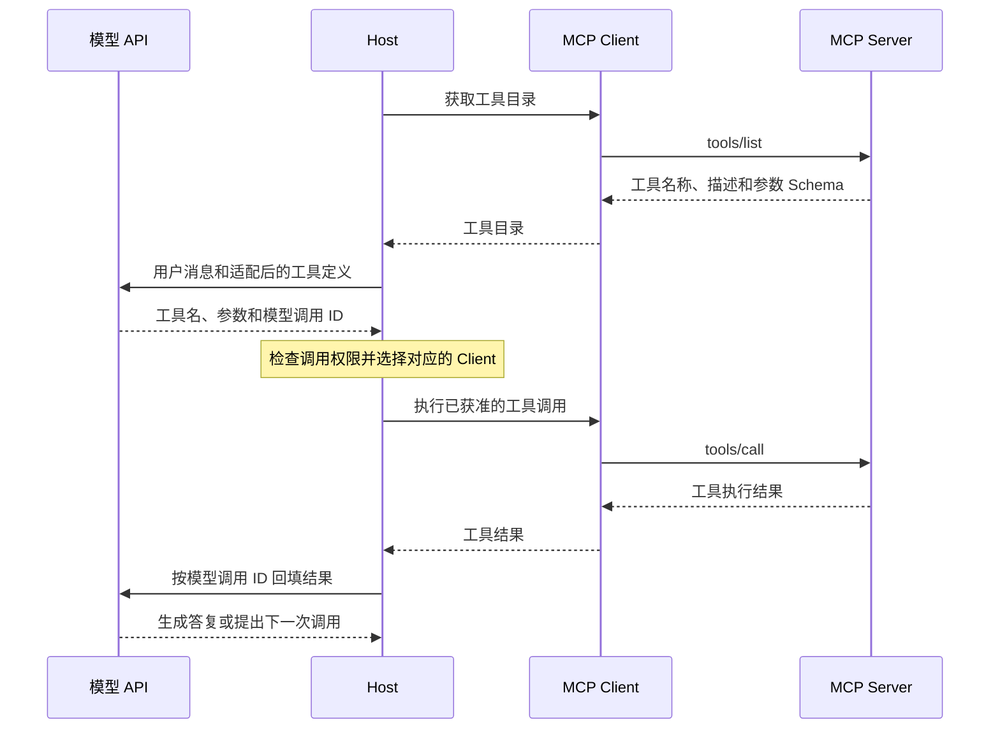

# MCP 接入与执行机制

MCP（Model Context Protocol）约定了 AI 应用怎样发现和使用外部能力。服务端可以把已有的函数、数据库查询或 HTTP API 包装成统一接口，兼容的宿主按同一套协议接入。例如，几个 Agent 应用可以共用一个知识库检索服务，各自决定什么时候检索、怎样用检索结果回答问题。本文以 `2026-07-28` 版规范为基准。 [MCP 规范](https://modelcontextprotocol.io/specification/2026-07-28)

## 1. 整体架构与调用链

**Host** 是用户正在使用的 AI 应用，负责管理对话、模型请求和执行策略。它为每个接入的 **MCP Server** 管理一个 **MCP Client**，由 Client 收发协议消息。Server 注册工具，并把具体的请求交给业务处理函数。

这里有两个接口。模型 API 与 Host 之间使用 **Tool Calling**，交换工具定义、调用请求和工具结果。Client 与 Server 之间使用 **MCP**，交换外部能力的目录和执行请求。Host 负责把两个接口接起来。 [MCP 架构](https://modelcontextprotocol.io/docs/2026-07-28/learn/architecture)

## 2. 工具从发现到执行

### 注册与路由

`tools/list` 返回工具列表，每项带有名称和 `inputSchema`，也可以提供描述。描述帮助模型判断什么时候该用工具，Schema 定义参数的结构。目录分页时，Client 可用响应里的 `nextCursor` 继续读取。Host 按本轮任务与权限挑选工具，再转成模型 API 支持的定义。工具描述也占用模型输入预算，目录较大时可以按需提供。 [MCP Tools 规范](https://modelcontextprotocol.io/specification/2026-07-28/server/tools#listing-tools)

工具名的唯一性范围是单个 Server。两个 Server 都提供 `search` 时，Host 可以为模型注册 `java_search` 和 `issues_search`，并保留模型侧名称到「Server 配置标识、原始工具名」的映射。模型返回 `java_search` 后，Host 查映射选中 Client，再用原名 `search` 发起 `tools/call`。当工具目录或授权范围变化时，Host 要更新可用定义和路由映射。 [工具名称与命名冲突](https://modelcontextprotocol.io/specification/2026-07-28/server/tools#tool-names)

### 结果适配

`tools/call` 的结果可以包含文本、图像等 `content` 内容块，也可以用 `structuredContent` 返回程序可读取的 JSON 值。工具声明 `outputSchema` 时，Server 的结构化结果须符合该 Schema，Client 可以据此校验。Host 可以用结构化字段驱动后续流程，并从结果里选取模型需要的证据。比如知识库检索返回片段和来源定位，Host 按上下文预算取片段，同时保留引用。 [工具结果与输出 Schema](https://modelcontextprotocol.io/specification/2026-07-28/server/tools#tool-result)

## 3. Server 能提供哪些能力

| 能力 | 访问方式 | 适用内容 |
|---|---|---|
| Tools | `tools/list`、`tools/call` | 带参数执行操作，比如按问题检索知识库，也可以执行写入 |
| Resources | `resources/list`、`resources/read` | 按 URI 读取资料，比如由 Host 加载一份数据库 Schema 或文档 |
| Prompts | `prompts/list`、`prompts/get` | 按名称取得可复用的提示模板，比如用户主动选用的代码审查模板 |

是否由模型提出调用、由应用加载资料，或由用户挑选模板，是宿主在交互中采用的使用方式。不同能力可以组合，比如先用 Tool 查到文档，再按资源 URI 加载原文。 [MCP Server 能力](https://modelcontextprotocol.io/docs/2026-07-28/learn/server-concepts)

## 4. 本地进程与 HTTP 接入

本章的 stdio 探针使用 Python SDK 1.27.0，实测协商到 `2025-11-25` 版。可以观察初始化、工具目录、查询结果和参数错误。下表和后文的版本对照按所标注的协议版本阅读。 [MCP 跨进程实验](../agent-practice/README.md#实验三-跨进程-mcp-工具调用)

两种标准传输都承载 JSON-RPC 消息。`tools/list` 和 `tools/call` 的含义相同，进程生命周期、消息收发和认证配置有各自的规则。 [MCP 传输规范](https://modelcontextprotocol.io/specification/2026-07-28/basic/transports)

| 传输 | 怎么连接 | 开发和排错时看哪里 |
|---|---|---|
| `stdio` | Client 启动本地 Server 子进程，通过 `stdin` 写请求，通过 `stdout` 读协议消息 | 检查启动命令、工作目录、环境变量和进程权限。`stdout` 用于协议消息，诊断日志写 `stderr` |
| `Streamable HTTP` | Client 向 Server 的 MCP URL 发送 HTTP POST，响应可以是 JSON 或 SSE 流 | 检查 URL、部署和代理的超时设置，以及受保护服务的凭证与授权范围 |

协议版本会影响连接后的第一条消息。`2025-11-25` 版通过 `initialize` 协商版本和能力，完成后发送 `notifications/initialized`。`2026-07-28` 版由每个请求在 `_meta` 携带协议版本与客户端能力，Client 可以先用 `server/discover` 查询服务端支持的版本和能力。读 SDK 或对照日志时，先确认双方支持的协议版本。 [2025 年版生命周期](https://modelcontextprotocol.io/specification/2025-11-25/basic/lifecycle) · [2026 年版兼容机制](https://modelcontextprotocol.io/specification/2026-07-28/basic/versioning)

## 5. 权限在哪里检查

**Host 检查用户授权与调用范围。** 模型给出的工具名和参数先经过应用策略，调用工具时带上完成任务所需的数据。涉及敏感数据传输或外部写入时，Host 根据授权规则决定是否需要用户确认。工具描述和返回文本作为外部数据处理，执行权限由应用策略控制。 [MCP 安全原则](https://modelcontextprotocol.io/specification/2026-07-28#security-and-trust-safety)

**Server 检查身份、参数和目标资源。** 服务端校验工具输入，并按请求者权限判断可访问哪些数据、可执行哪些动作。HTTP 接入使用 MCP 授权时，Client 随请求带凭证，Server 核验凭证及其授权范围。`stdio` 接入时，进程能访问的本地资源受启动身份和运行环境约束。`readOnlyHint`、`idempotentHint` 等注解可以给 Host 提供线索，权限和重试仍以实际访问控制及业务契约为准。 [MCP 授权](https://modelcontextprotocol.io/specification/2026-07-28/basic/authorization) · [工具权限要求](https://modelcontextprotocol.io/specification/2026-07-28/server/tools#security-considerations)

## 6. 一次调用失败后怎么处理

| 故障来源 | 可观察的信号 | 处理方式 |
|---|---|---|
| 传输或 HTTP | 子进程退出、连接超时、HTTP 授权失败 | 检查进程、网络或身份。对可恢复故障，在剩余预算内依据工具契约重试 |
| MCP 协议 | JSON-RPC `error`，例如工具名未知、请求结构非法 | 按错误码定位。工具名失效时刷新目录并核对本地路由 |
| 工具执行 | `result.isError` 为 `true`，例如参数超过业务上限或下游查询失败 | 保存业务错误。参数可以修正时，把错误原因和允许的范围交给模型 |

HTTP 传输先看状态码，再读 MCP 响应。普通工具调用完成时，结果里的 `resultType: "complete"` 表示这轮请求已结束，业务是否成功还要看 `isError` 和实际结果。检索正常执行但没有命中时，空列表可以是成功结果。排查时保留实际响应类型。比如规范将未知工具列为协议错误，Python SDK 的 `MCPServer` 可以返回带错误标记的工具结果。 [MCP Tools 错误处理](https://modelcontextprotocol.io/specification/2026-07-28/server/tools#error-handling) · [Python SDK 客户端](https://py.sdk.modelcontextprotocol.io/client/)

模型工具调用 ID 用于把结果交还给对应的模型调用。JSON-RPC `id` 用于关联 Client 与 Server 之间的请求和响应。写入前还要保存稳定的业务操作标识，恢复时用它关联多次尝试。Host 可以在执行记录里一起保留这些标识，定位故障发生在哪一侧。

请求已发出、写入结果尚未知时，把步骤记为「待核对」。如果可以查询远端操作状态，先确认有没有生效。如果接口支持幂等，则按对应契约用保存的键和参数重试。这个恢复决策沿用 Agent 的执行状态。 [Agent 状态](2.%20Agent%20状态.md)

## 7. 接到当前 Java RAG 的哪一层

现有 `search.py` 按 `--document-id` 选择向量索引，把问题编码为向量并检索 Top-K，报告里保留命中片段、分数、源文件和原文位置。生成阶段使用这些证据，让模型给出带引用的答案。 [现有检索入口](../../2.%20RAG/rag-practice/search.py) · [RAG 实验](../../2.%20RAG/rag-practice/README.md)

单个问答程序可以直接执行这段检索流程。需要让多个宿主查同一套资料时，可以把检索逻辑提成查询函数，由 MCP Server 注册为只读工具 `search_java_knowledge`。服务端按配置选择索引，工具接收 `question` 和有上限的 `top_k`，用结构化结果返回片段和来源。Host 用这些结果组装模型上下文，并在答案里保留引用。索引覆盖哪些文档由 RAG 检索层决定。

读本章实验时，可以从 `ClientSession.list_tools()`、`ClientSession.call_tool()` 跟到实际请求，再看服务端怎样将 `tools/call` 交给已注册的处理函数。模型消息和工具 ID 的适配在 Host 层，工具调用实验演示了这一步。 [MCP 探针](../agent-practice/mcp_probe.py) · [MCP Server](../agent-practice/mcp_server.py) · [Tool Calling 实验](../agent-practice/agent.py)
